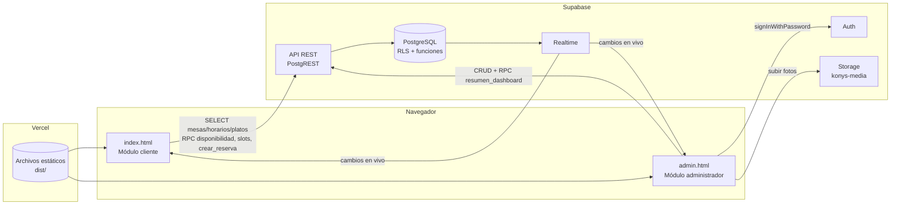
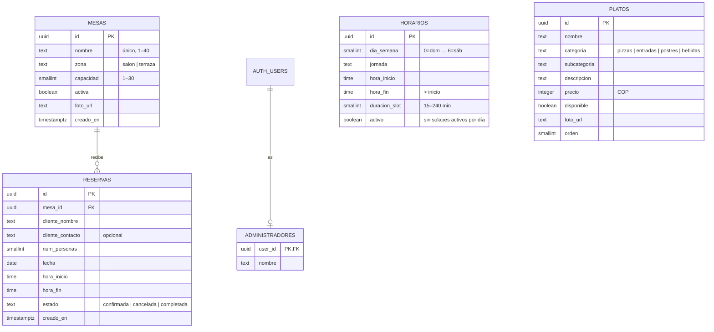
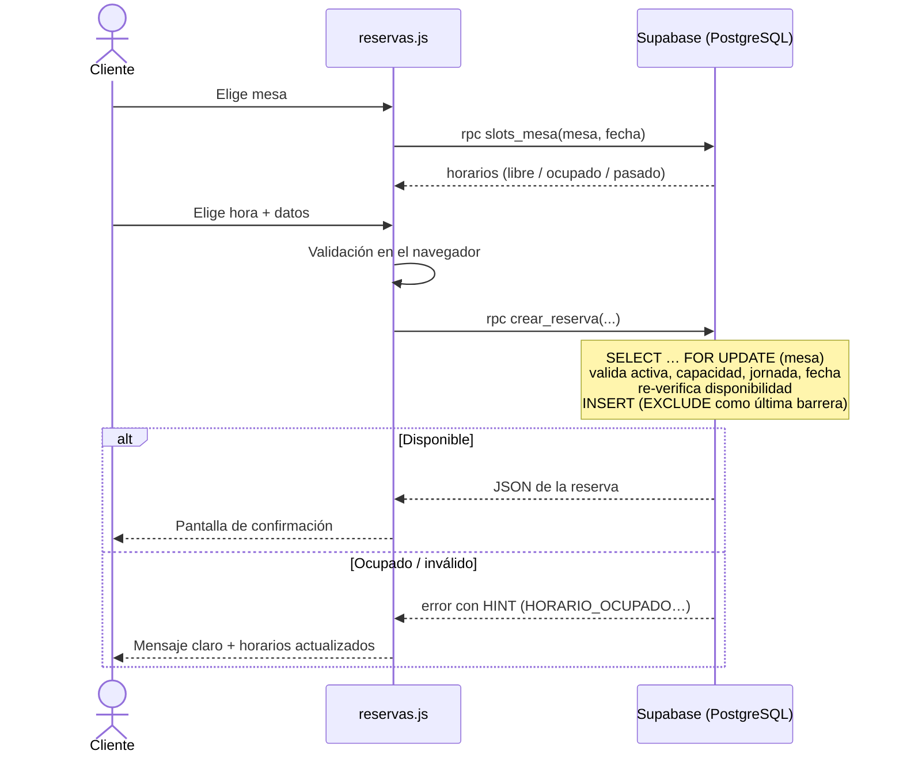

# Arquitectura

## Vista general



- Sin backend propio: toda la lógica sensible vive en PostgreSQL (restricciones, triggers y funciones) y se protege con RLS.
- El frontend se organiza en módulos ES: `api.js` es la única capa que habla con Supabase; las vistas solo pintan y reaccionan.

## Modelo de datos



Restricción clave contra reservas dobles:

```sql
constraint reservas_sin_solape exclude using gist (
  mesa_id with =,
  tsrange(fecha + hora_inicio, fecha + hora_fin, '[)') with &&
) where (estado <> 'cancelada')
```

## Flujo de reserva



## Decisiones

| Decisión | Motivo |
|---|---|
| HTML/CSS/JS sin framework | Requisito del proyecto; menos peso y cero build obligatorio. |
| Reservas solo por RPC | El público nunca escribe en tablas; todas las reglas se validan en el servidor en una transacción. |
| `EXCLUDE` + `FOR UPDATE` | Imposibilita reservas cruzadas aun con solicitudes simultáneas. |
| Vista `v_reservas` (`security_invoker`) | Une reservas con mesas respetando el RLS del administrador. |
| Tabla `administradores` | Tener una cuenta de Auth no basta para administrar. |
| Fechas en `America/Bogota` | "Hoy" y "horario pasado" se calculan igual en el servidor y en el navegador. |
| `scripts/build.mjs` | Inyecta variables de entorno en un sitio estático sin agregar dependencias. |
